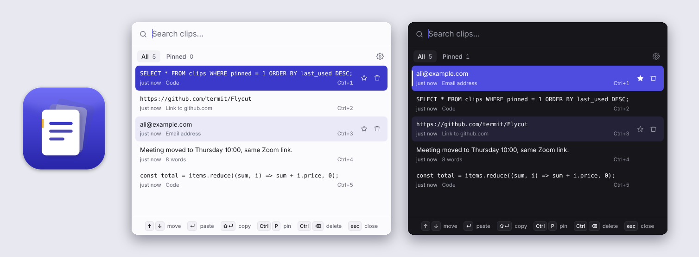
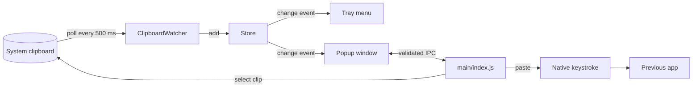

# ClipVault

[](https://github.com/AliMora83/ClipVault/actions/workflows/ci.yml)
[](LICENSE)

A keyboard-first clipboard history manager for macOS, Windows and Linux, inspired by [Flycut](https://github.com/TermiT/Flycut).

ClipVault lives in your menu bar, saves everything you copy, and pastes any earlier clip back into the app you're using with one shortcut.



## Features

- **Background capture** of every text copy, from any app, with duplicates moved to the top instead of piling up
- **One shortcut to paste**: ⌘⇧V (Ctrl+Shift+V), arrow to a clip, Enter. It pastes straight into the app you came from. Picking a clip from the menu bar pastes too.
- **Search, pin and quick-pick** (⌘/Ctrl + 1–9). Pinned clips are never trimmed or cleared.
- **Respects passwords:** skips clips that password managers mark as concealed (1Password, Bitwarden, KeePassXC and others)
- **Readable at a glance:** links and code shown in monospace and labelled; prose in the system font
- **Usage stats you own:** a monthly Usage screen (clips used, pasted, captured, found by search, a daily chart) and a summary notification on the 1st. Counts only, stored on your computer, exportable as CSV, and switchable off.
- **Local only:** history and stats are JSON files in your user-data folder; nothing leaves your machine
- Light and dark themes that follow the system; configurable shortcut, history size, pause and launch at login

## Install

Download the installer for your platform from [Releases](https://github.com/AliMora83/ClipVault/releases), or run from source (Node.js 20.11+):

```bash
git clone https://github.com/AliMora83/ClipVault.git
cd ClipVault
npm install
npm start
```

On macOS, pick the `arm64` file for Apple Silicon Macs and the `x64` file for Intel Macs.

The builds are not code-signed yet. On macOS, right-click the app and choose **Open** the first time.

### Paste permission

Pasting into another app needs one-time permission:

- **macOS:** turn on ClipVault in **System Settings → Privacy & Security → Accessibility**, then quit and reopen it. When running from source, turn on the app you ran `npm start` from (Terminal, iTerm, VS Code or Cursor) instead. If the permission is missing, ClipVault says so and opens the right page.
- **Windows:** nothing to do.
- **Linux:** install `xdotool` on X11. Wayland doesn't allow simulated keystrokes, so press Ctrl+V yourself.

## Keyboard

| Action                        | Keys                                       |
| ----------------------------- | ------------------------------------------ |
| Open / close                  | ⌘⇧V on macOS, Ctrl+Shift+V elsewhere       |
| Move                          | ↑ ↓ (PageUp / PageDown for first and last) |
| Paste into the previous app   | Enter                                      |
| Copy only                     | Shift+Enter                                |
| Quick pick                    | ⌘/Ctrl + 1…9                               |
| Search                        | Start typing                               |
| Pin / unpin                   | ⌘/Ctrl + P                                 |
| Delete                        | ⌘/Ctrl + Backspace                         |
| Switch between All and Pinned | Tab                                        |
| Settings                      | ⌘/Ctrl + ,                                 |
| Clear the search, then close  | Esc                                        |

## Architecture



```
src/
  main/            Electron main process
    index.js       wires everything together
    store.js       history + settings, persisted as JSON, emits "change"
    capture.js     ClipboardWatcher: polls, skips concealed and duplicate clips
    stats.js       local usage counts, monthly summaries, CSV export
    popup.js       frameless window that opens at the cursor
    tray.js        menu bar / tray menu
    hotkey.js      global shortcut
    paste.js       native keystroke with scripted fallbacks
    native-keys.js CoreGraphics / user32 bindings via koffi
    ipc.js         IPC handlers: sender check + validation
    ipc-validate.js
  preload.cjs      contextBridge API for the sandboxed popup
  renderer/        popup UI (vanilla ES modules, no framework or bundler)
  shared/          pure logic used by both processes (clip types, formatting, shortcuts)
test/
  unit/            node:test, no Electron needed
  e2e/smoke.js     boots the real app and drives it with the keyboard
```

### Design decisions

- **Polling, not events.** No platform exposes a cross-platform clipboard-changed event to Electron. A 500 ms poll on Electron's async clipboard API is cheap, and a guard prevents overlapping reads.
- **Native paste through FFI.** FlyCut posts a ⌘V keystroke from its own process. ClipVault does the same through [koffi](https://koffi.dev), calling CoreGraphics on macOS and `user32` on Windows. koffi ships prebuilt binaries, so there's no native build step, and macOS needs only the Accessibility permission. If the library can't load, ClipVault falls back to AppleScript or PowerShell.
- **The popup is untrusted.** It runs sandboxed with context isolation and a strict Content Security Policy. Every IPC call checks its sender and validates arguments (`ipc-validate.js`) before touching state. Clip text is only ever inserted as DOM text, never HTML.
- **Pure logic is shared and tested.** Clip classification, formatting, shortcut parsing and key mapping live in plain ES modules that both processes import and that run under `node --test` without Electron.

## Development

```bash
npm start          # run the app
npm test           # unit tests
npm run test:e2e   # end-to-end smoke test (Linux: xvfb-run -a npm run test:e2e -- --no-sandbox)
npm run lint       # ESLint
npm run format     # Prettier
npm run dist       # build an installer for this OS into dist/
```

CI runs lint, formatting and unit tests on macOS, Windows and Linux, plus the end-to-end test on Linux. Pushing a `v*` tag builds installers for all three platforms and attaches them to a draft GitHub Release.

## Roadmap

- Colour clips: swatches for HEX, RGB and HSL values, with paste-as conversion
- Paste as plain text, trimmed, or with changed case
- Encrypted history file and per-app capture exclusions
- Image clips

## Credits

Inspired by [Flycut](https://github.com/TermiT/Flycut) (MIT). Built by [Ali Mora](https://github.com/AliMora83).

## License

[MIT](LICENSE)
